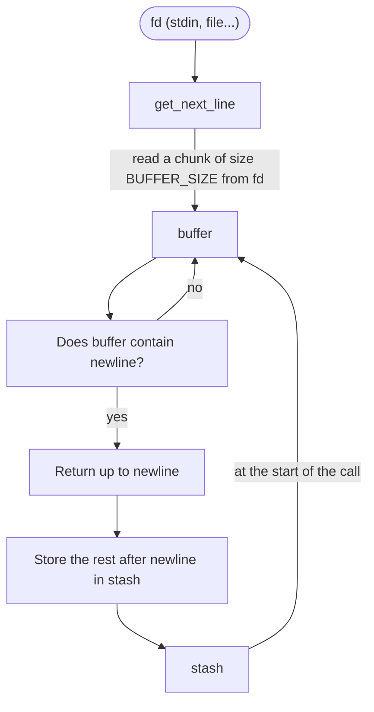

*This project has been created as part of the 42 curriculum by tdefeche*

# Get next line

## Description

This project is the creation of an iterator: a function that reads a file descriptor and returns the next line every time we call it on the same file descriptor.

## Instructions

> [!NOTE]
> For instructions on how to evaluate this project, refer to the [testing section](#testing)

1. Clone the repository
```bash
git clone -depth 1 https://github.com/zivoxRoot/ft_get_next_line.git
cd ft_get_next_line
```

2. Compile the program with a custom `main.c` file
```bash
cc -Wall -Wextra -Werror -g -D BUFFER_SIZE=2 get_next_line.c get_next_line_utils.c main.c
```

> [!NOTE]
> Change *BUFFER_SIZE* to verify the behavior of the function stays the same

3. Use the generated executable
```bash
./a.out  # Use stdin as the file descriptor
./a.out test.txt  # Use a file
```

<details>
<summary>

## Algorithm

</summary>

The idea is to use a *static variable* to keep the necessary context between two calls to the `get_next_line` function.

> A static variable keeps its value between two calls to the function containing it

**Instructions**

We need to return the next file from the **file descriptor** (**fd**) at each call

**Method**

We will read the **fd** by chunks of size *BUFFER_SIZE* until we have a *newline character* (`\n`), then return up to it and keep the rest of the line in the static variable for the next call to use.



**Known limitations**

- I didn't do the bonus of handling multiple file descriptor, so if the function is called multiple times but passing in different **fd**s it will have undefined behaviors

</details>

## Resources

I used AI to verify edge cases on my program, and a little bit to restructure it after my terrible design decisions.

An unsorted list of useful websites and articles

- [Static variables in C](https://www.geeksforgeeks.org/c/static-variables-in-c)

## Testing

You can copy this main file to test the program:

> [!NOTE]
> Then use the command at step 2 of the [instruction section](#instructions)

<details>
<summary><code>main.c</code></summary>

```c
#include <stdio.h>
int	main(int argc, char **argv)
{
	int 	fd;
	char	*str;

	if (argc == 1)
		fd = 0;
	else
	{
		fd = open(argv[1], O_RDONLY);
		if (fd < 0)
		{
			printf("Error opening file\n");
			return (1);
		}
	}
	while ((str = get_next_line(fd)))
	{
		printf("%s", str);
		free(str);
		sleep(1);
	}
	close(fd);
	return (0);
}
```

</details>
