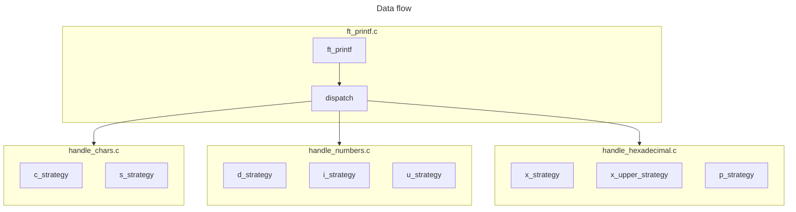

*This project has been created as part of the 42 curriculum by tdefeche*

# Get next line

## Description

This project is the creation of an iterator: a function that reads a file descriptor and returns us the next line every time we call it on the same file descriptor.

## Instructions

> [!NOTE]
> For instructions on how to evaluate this project, refer to the [testing section](#testing)

1. Clone the repository
```bash
git clone -depth 1 https://github.com/zivoxRoot/ft_get_next_line.git
cd ft_get_next_line
```

2. Compile the program
```bash
cc -Wall -Wextra -Werror -g -D BUFFER_SIZE=2 main.c
```

3. Use the generated executable
```bash
./a.out  # Use stdin as the file descriptor
./a.out test.txt  # Use a file
```

4. For exemple create this simple `main.c` before running the above command
```c
#include <stdio.h>

#include "ft_printf.h"

int	main(void)
{
	char	*prog_name = "printf";
	ft_printf("Hello from my custom %s\n", prog_name);
}
```
<details>
<summary>

## Algorithm & architecture

</summary>

This project is organized as a centralized dispatcher calling different data types handlers to convert the needed types into printable text.

> Each `.c` file has a corresponding `.h` file for others to import its "public" functions cleanly

### Dispatcher

The entry point is [ft_printf.c](ft_printf.c), which contains the `ft_printf` function and the `dispatch` function.

`ft_printf` handles writing standard chars and passing special type indicators to `dispatch`.

`dispatch` is called by `ft_printf` every time the latter encounters a `%{x}` substring in its first argument. It simply routes the argument to the corresponding handler if it exists, or prints an error message if there is no handler for this type indicator.

### Handlers

Handlers are grouped in the [handlers](./handlers) folder by the type they work with: `handle_chars`, `handle_numbers`, handle_hexadecimal`.

They all follow the same structure of being a simple function returning an int (the size of the printed string), taking a pointer to a *va_list* as only argument.

Handlers can have static helpers, `ft_putnbr`/`ft_putunbr` for the numbers handler, `ft_putstr` for the chars handler, and `ft_putnbr_base` for the hexadecimal handler.

### Data flow



### How to add a handler

1. Add a condition to `dispatch`
```diff
int dispatch(char type_indicator, va_list *args)
{
	if (type_indicator == 'c')
		return (c_strategy(args));
+	if (type_indicator == 'z')
+		return (z_strategy(args));
	if (type_indicator == 's')
		return (s_strategy(args));
```

2. Add a new handler in a file in the [handlers](./handlers) folder
```diff
// handlers/handler_chars.c

+ int z_strategy(va_list *args)
+ {
+ 	char    *str;
+ 
+ 	str = (char *)va_arg(*args, char *);
+ 	return (ft_putstr(ft_change_case(str)));
+ }
+ 
+ int	ft_change_case(char *str)
+ {
+ 	...
+ }
```

</details>

## Resources

I used AI to simplify the global architecture of this project because it was initially too complex. I also used it to debug some obscure recusion problem because I went this way for my `putnbr` and `putnbr_base`.

An unsorted list of useful websites and articles

- [Makefile explanation & example](https://linuxvox.com/blog/makefile-linux-c-example)
- [Creating a static library in C](https://www.geeksforgeeks.org/c/how-do-i-create-a-library-in-c)
- [Man pages](http://manpagesfr.free.fr/man/man3/stdarg.3.html) for `va_list`

## Testing

You can easily test this library using the following `main.c`

> [!NOTE]
> After copying it refer to the step 3 of the [instructions](#instructions)

<details>
<summary><code>main.c</code></summary>

```c
#include <stdio.h>

#include "ft_printf.h"

int	main(void)
{
	char 			c = 'X';
	char			*str = "Salut bonjour";
	int				n = -1;
	unsigned int	un = -1;
	unsigned int	hex = 932;
	char			*ptr = str;

	int	s_original;
	int	s_mine;

	printf("=== Litteral '%%' character with %%%% ===\n");
	s_original = printf("O: %%\n");
	s_mine = ft_printf("M: %%\n");
	printf("Size return (original / mine): %d / %d\n\n", s_original, s_mine);

	printf("=== Single character with %%c ===\n");
	s_original = printf("O: %c\n", c);
	s_mine = ft_printf("M: %c\n", c);
	printf("Size return (original / mine): %d / %d\n\n", s_original, s_mine);

	printf("=== String with %%s ===\n");
	s_original = printf("O: %s\n", str);
	s_mine = ft_printf("M: %s\n", str);
	printf("Size return (original / mine): %d / %d\n\n", s_original, s_mine);

	printf("=== Int with %%d ===\n");
	s_original = printf("O: %d\n", n);
	s_mine = ft_printf("M: %d\n", n);
	printf("Size return (original / mine): %d / %d\n\n", s_original, s_mine);

	printf("=== Int with %%i ===\n");
	s_original = printf("O: %i\n", n);
	s_mine = ft_printf("M: %i\n", n);
	printf("Size return (original / mine): %d / %d\n\n", s_original, s_mine);

	printf("=== Unsigned int with %%u ===\n");
	s_original = printf("O: %u\n", un);
	s_mine = ft_printf("M: %u\n", un);
	printf("Size return (original / mine): %d / %d\n\n", s_original, s_mine);

	printf("=== Lowercase hexa int with %%x ===\n");
	s_original = printf("O: %x\n", hex);
	s_mine = ft_printf("M: %x\n", hex);
	printf("Size return (original / mine): %d / %d\n\n", s_original, s_mine);

	printf("=== Uppercase hexa int with %%X ===\n");
	s_original = printf("O: %X\n", hex);
	s_mine = ft_printf("M: %X\n", hex);
	printf("Size return (original / mine): %d / %d\n\n", s_original, s_mine);

	printf("=== Pointer with %%p ===\n");
	s_original = printf("O: %p\n", ptr);
	s_mine = ft_printf("M: %p\n", ptr);
	printf("Size return (original / mine): %d / %d\n\n", s_original, s_mine);
}
```

</details>
